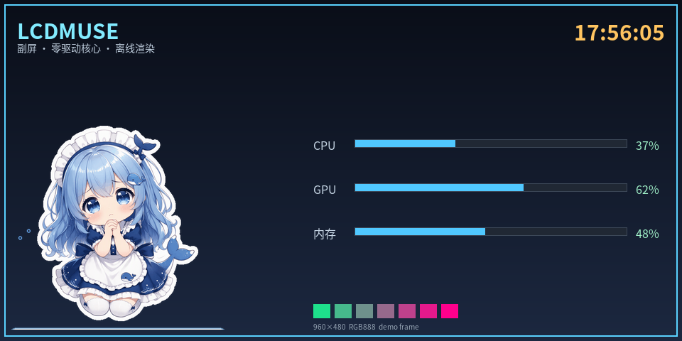

# lcdmuse

lcdmuse 可以把时间、CPU 和内存占用显示在机箱里的 USB 小屏上。你可以只看数据，也可以在同一块屏上养一只会吃饭、会打盹的桌宠。手边没有副屏，也能先在电脑上预览效果。



## 先生成一张预览图

准备好 Git 和 Python 3.10 或更高版本，在终端运行下面四行命令。如果已经下载并解压了源码，直接在含有 `pyproject.toml` 的目录里运行最后两行即可。

```shell
git clone https://github.com/Phenix704/lcdmuse.git
cd lcdmuse
python -m pip install -e .
lcdmuse render --offline --theme deepsea --pet whale-girl --out out/preview.png
```

打开项目目录里的 **`out/preview.png`**，就能看到一张 960 × 480 的「深海月光」主题图，上面有当前时间、系统占用和桌宠。这一步只生成一张静态图，全程无需连接设备。

## 换个样子

主题决定背景和数据的摆放位置，桌宠可以单独开关。下面这条命令保留深海背景，只显示时间和系统数据。

```shell
lcdmuse render --offline --theme deepsea --pet none --out out/monitor.png
```

仓库还自带 `neon-harbor`（夜港霓虹）和 `bezel-mask`（侧栏蒙版）。把命令里的 `deepsea` 换成对应名字，就能预览另一套主题。用 `lcdmuse themes list` 和 `lcdmuse pets list` 可以查看本机有哪些主题和桌宠。

## 接上 USB 副屏

先确认屏幕型号和硬件版本。仓库带有 Turing Rev A/B/C/D、TURZX USB 和 WeAct A/B 的驱动。这些驱动默认不参与自动探测，项目尚未在真机上验证这些适配器。如果手头只有尺寸或分辨率，可以先对照[上游屏幕型号图鉴](https://github.com/mathoudebine/turing-smart-screen-python/wiki/Hardware-revisions)。

**1. 在项目目录里安装依赖，查看驱动列表。**

```shell
python -m pip install -e ".[tray,drivers]"
lcdmuse drivers list
```

列表里的 `id` 是驱动名。`available` 一栏显示软件能否加载这个驱动。下一步再检查驱动能否找到你的屏幕。

**2. 启用对应驱动并探测屏幕。** 以 Turing Rev A 为例，在项目根目录新建 `lcdmuse.yaml`，写入下面几行。如果文件已经存在，把对应条目加到现有的 `drivers` 下。

```yaml
drivers:
  turing_rev_a:
    enabled: true
```

插上屏幕，用刚启用的驱动查找设备。

```shell
lcdmuse probe --plugin turing_rev_a
```

如果输出里有设备名和分辨率，就可以启动控制面板。若只返回 `[]`，说明该驱动没有找到设备，先核对屏幕版本、驱动名和 USB 连接。使用其他型号时，把配置和命令里的 `turing_rev_a` 都换成对应驱动的 `id`。

**3. 启动控制面板，让画面持续更新。**

```shell
lcdmuse tray --plugin turing_rev_a
```

启动后，本机控制面板会显示当前画面和刷新速度。你可以在面板里暂停刷新、开关桌宠，也可以从系统托盘重新打开面板或退出程序。想先在电脑上试用面板，可以把驱动名换成 `simulated`。

## 让 AI 控制屏幕（可选）

保持托盘程序运行，在支持 MCP 的 AI 客户端里添加一个本地服务。启动命令填 `lcdmuse`，参数填 `mcp` 和 `--stdio`。连接后可以直接说「把副屏主题换成夜港霓虹（neon-harbor）」或「看看副屏现在显示的画面」。如果客户端返回 `device_offline`，先确认托盘程序正在运行。

## 自定义与开发

- 想换自己的底图或调整数据位置，见[主题说明](docs/THEMES.md)。
- 想保存默认主题、桌宠或给两块屏分别选主题，见[配置示例](lcdmuse.example.yaml)。
- 想画自己的桌宠，见[桌宠模板](pets/_template/README.md)。
- 想接入新型号或用脚本控制屏幕，见[开发指南](docs/AI-GUIDE.md)第 6 节（驱动）和第 9 节（MCP）。

lcdmuse 基于 [turing-smart-screen-python](https://github.com/mathoudebine/turing-smart-screen-python) 开发，代码采用 [GPL-3.0-or-later](LICENSE)。详见[相对上游的改动](docs/MODIFICATIONS.md)和[第三方项目与素材署名](docs/THIRD-PARTY.md)。
