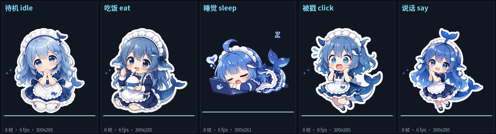

# lcdmuse

把机箱里那块小 USB 屏（串口 / HID）变成第二块屏：显示系统状态、养一只桌宠、也可以让脚本或 AI 直接推画面。


*上图是 `lcdmuse render --offline` 的真实输出（960×480，无硬件）。左边是桌宠，右边是数据条，底部色条用来检查颜色对不对。*


[](./LICENSE)


## 为什么还要再造一个

现成的副屏软件大致三类，各有各的坑：

- **厂商软件**（屏幕厂商自带的控制软件）：界面停在五年前，不能脚本化，只认自家屏，还常驻后台每 5 秒扫一遍硬件。
- **上游开源项目**（[turing-smart-screen-python](https://github.com/mathoudebine/turing-smart-screen-python)）：功能很全，但 8 个机型的驱动被写死在核心里 —— 加一块新屏就得改核心代码。
- **灯效软件**（OpenRGB 等）：只管 RGB，不管屏。

lcdmuse 的做法：**核心只认契约，不认硬件**。屏幕是谁家的、什么协议、多少波特率，全在插件里。

## 三种用法

| 用法 | 说明 | 状态 |
|---|---|---|
| **系统监控** | CPU / GPU / 内存 / 磁盘 / 网络画成一张主题图，定时推到屏上 | 渲染与调度已就绪，主题引擎还在接（现在是测试卡） |
| **桌宠** | 一个会呼吸、会吃、会被戳的 Q 版角色，**画在副屏上**，不是 Windows 桌面挂件 | 可用，5 个状态 |
| **AI 接管** | 通过 MCP 让 DSH / Claude 之类的代理调用 `show_image` / `push_frame` / `pet_set` | 未开工（`lcdmuse-daemon` + `lcdmuse-mcp`） |

> 关于桌宠：它渲染在**机箱副屏那块屏上**，和主题共用一张画布、同一帧通路 —— 主题先画整幅，再按锚点把桌宠贴上去。所以关掉桌宠，屏幕就回到普通主题，两者不是互斥的两套模式。它也不是 Windows 桌面上的宠物挂件。

## 快速开始（不用接屏）

```bash
git clone https://github.com/LycoRepo/lcdmuse.git
cd lcdmuse
pip install -e ".[dev]"

lcdmuse drivers list        # 插件表
lcdmuse render --offline --pet whale-girl --out out/preview.png
```

第三条命令走内置的 `simulated` 驱动，**一根线都不用插**，直接出上面那张图。

接上真屏之后：

```bash
lcdmuse probe               # 探测当前接的设备
lcdmuse drivers list        # 看哪个插件认领了它
lcdmuse render --plugin <id> --out out/screen.png
```

## 控制台（本地 Web 面板）

`lcdmuse tray` 起来时会同时在 `127.0.0.1` 上开一个控制台，用 Edge/Chrome 的 `--app` 窗口展示（没有地址栏，像个真程序）。托盘图标左键随时重开；`LCDMUSE_SHOW_WINDOW=0` 可以只留托盘。

面板做三件事：左栏选设备（名字可以自己改，见下）、中栏看这台屏的驱动/帧率/配置、右栏直接预览**驱动真实推出去的那一帧**以及最近 60 秒帧率曲线。暂停/桌宠/退出都在面板上。

### 主题和桌宠也是插件

合成顺序是固定的：**底图 → 主题（蒙版 + 数据）→ 桌宠**。所以底图可以随时换成一张图、一张动图或一段视频，主题只决定「蒙版长什么样、数据摆哪儿」。

| 类型 | 仓库目录 | 用户目录（Windows） | 清单 |
|---|---|---|---|
| 驱动 | `drivers/<id>/` | `%APPDATA%\lcdmuse\drivers` | `driver.yaml` |
| 主题 | `themes/<id>/` | `%APPDATA%\lcdmuse\themes` | `theme.yaml` |
| 桌宠 | `pets/<id>/` | `%APPDATA%\lcdmuse\pets` | `pet.json` |

同名时用户目录那份优先。仓库自带一个 `themes/bezel-mask/`（右侧数据面板 + 半透明蒙版）作范例。

**数据接口**供主题绑定：`lcdmuse.metrics.read()` / `lcdmuse metrics --catalog` / `GET /api/metrics`，指标名如 `cpu.percent`、`mem.percent`、`gpu.mem_percent`、`net.rx_kbps`、`time.now`、`uptime.hours`；取不到的指标不出现，主题里用 `default:` 兜底。想加自己的指标，`get_hub().register("myapp", fn)` 即可。

```bash
lcdmuse themes list                                     # 有哪些主题插件
lcdmuse pets list                                       # 有哪些桌宠插件
lcdmuse metrics --catalog                               # 指标清单
lcdmuse render --offline --theme bezel-mask --pet whale-girl --out out/preview.png
lcdmuse render --offline --background D:/wallpapers/loop.gif --out out/bg.png   # 换底图，主题不动
```

详见 `docs/AI-GUIDE.md` 第 7 节（三类插件的清单格式、蒙版元素、指标表）。

### MCP（让 DSH 这类代理接管）

托盘是唯一持有设备的进程，MCP 只是薄封装、不碰硬件：`lcdmuse mcp --stdio` 把 JSON-RPC 转给托盘内嵌的 `POST /mcp`。托盘没起就返回 `device_offline`，不假装成功。

```yaml
# DSH / 任意 MCP 客户端
mcpServers:
  lcdmuse:
    command: lcdmuse
    args: ["mcp", "--stdio"]
```

15 个工具：`lcd_list_devices`、`lcd_device_info`、`lcd_status`、`lcd_metrics`、`lcd_show_image`、`lcd_show_background`、`lcd_show_theme`、`lcd_render_preview`、`lcd_push_frame`、`lcd_set_brightness`、`lcd_set_rotation`、`lcd_pet_list`、`lcd_pet_set`、`lcd_pet_state`、`lcd_pet_say`。图片一律传**文件路径**（不收 base64）；结果统一 `{ok, data, error}`，错误码 `device_offline` / `invalid_argument` / `unsupported`。

端口写在 `%APPDATA%\lcdmuse\runtime.json`，想固定就 `lcdmuse tray --port 7788`。详见 `docs/AI-GUIDE.md` 第 9 节。

### 界面是可改的，三层分开

| 层 | 位置 | 怎么改 |
|---|---|---|
| 界面 | `lcdmuse/web/`（`index.html` / `app.css` / `app.js`） | 直接改文件，**刷新页面就生效**，不用重启 |
| 接口 | `lcdmuse/webui.py` 的 `/api/*` | 回 JSON/PNG，跟界面无关；想接自己的前端 / 手机页面就调这几个 |
| 服务 | `lcdmuse/player.py`、`drivers/` 插件 | 推帧与设备，不关心谁在调它 |

`lcdmuse plugin add` 装完会自动写 `drivers.<id>.enabled: true`；如果是手动拷进用户目录，
清单里 `enabled_by_default: false` 的驱动默认不探测，要在配置里显式启用，日志会提示。

所有 POST（含 `/mcp`）都要带控制令牌，并只接受本机 Host / 同源 Origin：

```
X-LCDMUSE-Token: <runtime.json 里的 token>
```

令牌每次启动重新生成，写在 `%APPDATA%\lcdmuse
untime.json`（权限 600）；面板页面自带它，
脚本和 MCP 桥接从 runtime.json 读。没有令牌一律 403。

接口一览：

| 方法 | 路径 | 作用 |
|---|---|---|
| GET | `/api/status` | 所有设备：plugin、自定义名、自报型号、分辨率、帧数、fps、暂停、错误 |
| GET | `/api/preview?i=N` | 第 N 块屏当前那一帧（PNG） |
| POST | `/api/select` | `{"index":0}` 切换当前设备 |
| POST | `/api/pause` | `{"paused":true}` 或空对象=取反 |
| POST | `/api/pet` | `{"enabled":false}` 或空对象=取反 |
| POST | `/api/rename` | `{"index":0,"name":"机箱大屏"}` 写进 `device_names` |
| POST | `/api/open` | `{"target":"plugins"\|"logs"}` |
| POST | `/api/quit` | 释放设备并退出 |

想整套换掉前端（自己的皮肤、自己的布局）：把 `index.html` / `app.css` / `app.js` 放一个目录，然后

```bash
LCDMUSE_WEB_DIR=D:/my-skin lcdmuse tray --plugin all --interval 1
```

后端、驱动、设备都不用动。

**设备名可以自定义**：面板「重命名设备」按钮，或直接改 `lcdmuse.yaml`：

```yaml
device_names:
  <驱动 id>: 我的左屏      # 驱动 id 用 `lcdmuse drivers list` 查
  <驱动 id>: 我的右屏
```

留空就恢复成设备自报的名字。

## 托盘常驻

不想开控制台就挂托盘：

```bash
pip install -e ".[tray]"
lcdmuse tray --plugin all --interval 1     # all = 所有探测到的屏；也可只写一个插件 id
```

托盘图标（右下角，画的是块小屏 + 绿点表示在推）右键菜单：

| 菜单项 | 作用 |
|---|---|
| 打开主界面（左键也是它） | 打开本地控制台面板 |
| 第一行状态 | 设备名 · 当前 fps · 已推帧数（多屏时显示 N 块屏） |
| 暂停 / 继续 | 停推帧但保持设备占用；屏定格在当前画面 |
| 桌宠 | 一键开关桌宠跑马灯式的覆盖层 |
| 打开插件目录 | 打开 `%APPDATA%\lcdmuse\drivers` |
| 打开日志 | 打开 `logs/` |
| 退出 | 释放设备后退出 |

单实例：重复启动会直接提示"已经在运行"，不会两个进程抢同一块屏。

## 桌宠



从左到右：`idle` 待机、`eat` 吃饭、`sleep` 睡觉、`click` 被戳、`say` 说话。
默认款是 `whale-girl`（蓝发女仆 + 白饭碗，DeepSeek 娘化形象，素材 MIT）。

- **能关**：`--pet none`、配置里 `pet_enabled: false`，以后还会有托盘菜单和 MCP 开关
- **能换**：扔一个目录进 `pets/` 就行，`pet.json` 描述状态、帧数、锚点
- **自己做**：`python tools/petify.py --gif a.gif --state eat --out pets/my-pet`

帧率取决于屏：整帧推一次约 3fps（960×480 JPEG 走 921600 串口），只推桌宠区域能到 6–9fps —— 要看具体屏支不支持局部刷新，还没验证。

## 驱动就是插件

核心目录 `lcdmuse/` 里没有一个 VID/PID、命令字或波特率 —— 有一条测试专门盯着这件事：把它塞进去，测试就红。

装一个驱动有两种方式：

```bash
# 1) 放仓库里（适合开发）
drivers/my-screen/{driver.yaml, driver.py}

# 2) 装到用户目录（适合用户，不动源码，升级不丢）
lcdmuse plugin dir                          # 打印目录
lcdmuse plugin add path/to/my-driver        # 目录或 .zip
lcdmuse plugin list
lcdmuse plugin remove my-driver
```

用户目录：Windows `%APPDATA%\lcdmuse\drivers`，其它平台 `~/.config/lcdmuse/drivers`。
两个目录都扫，同一个 id 撞车时用户那份优先（`drivers list` 的 `origin` 列标明来源）。

`driver.yaml` 的最小样子：

```yaml
id: my-screen
name: 我那块屏
version: 0.1.0
api: 1                      # 契约版本
min_core: "0.1.0"           # 需要的最低核心版本，可选
entry: driver:Driver        # 文件:类名
requires: [serial]          # import 名，不是 pip 名
enabled_by_default: true
```

驱动只要继承 `lcdmuse.lcd_comm.LcdComm`，实现 `probe / open / close / push_frame` 就能跑；
`push_region`、`set_brightness`、`set_rotation`、`tick` 想支持哪个就覆盖哪个，不支持就抛 `Unsupported`。
完整说明见 [`docs/AI-GUIDE.md`](docs/AI-GUIDE.md)。

## 支持情况

| 屏 | 状态 |
|---|---|
| `simulated`（内置） | ✅ 可用，把帧存成 PNG，无硬件 |
| Turing rev A/B/C/D、TURZX USB、WeAct A/B | ⚠️ 适配层已就位、**未在真机验证**，默认不加载 |
| 串口 JPEG 屏（960×480） | 🚧 协议已实测（`55 AA` 帧 + 直接灌 JPEG），驱动待写 |
| HID 圆屏（480×480） | 🚧 协议未知，需要抓包逆向 |

上游项目支持哪些屏，见它的 [wiki](https://github.com/mathoudebine/turing-smart-screen-python/wiki/Hardware-revisions)；
本仓的适配器就是给那些机型留的。

## 项目结构

```
lcdmuse/                核心（零驱动）
  lcd_comm.py           契约：错误码、Capability、DeviceInfo、Frame、LcdComm
  plugin.py             扫 driver.yaml，校验 api / min_core / requires
  registry.py           多目录枚举 → probe → open；同 id 用户优先
  plugin_store.py       用户插件安装/卸载（目录或 zip，装完即时校验，失败回滚）
  render/               画布原语、颜色解析、脏矩形 diff、测试卡
  transport/            通用串口封装（无设备标识）
  pet.py                桌宠状态机 + 锚点合成
  cli.py                lcdmuse 命令
drivers/<id>/           驱动插件；simulated 是样板
pets/<name>/            桌宠帧包；_template 是模板
tools/                  GIF 抽帧、预览合成
tests/                  21 个用例，含"核心零设备知识"断言
docs/                   AI-GUIDE（开发约定）、阶段状态、改动清单
```

## 现在到哪一步了

**已完成**：契约 + 插件系统（含用户目录）+ 渲染与脏矩形 + 桌宠 + CLI + 离线验证。
**接下来**：主题引擎接 `res/themes` → `lcdmuse-daemon` 独占设备 → `lcdmuse-mcp` 给 AI 用 → 写串口屏驱动。

细节与缺口清单在 [`docs/STAGE1-STATUS.md`](docs/STAGE1-STATUS.md)。

## 与上游的关系

本仓是 [turing-smart-screen-python](https://github.com/mathoudebine/turing-smart-screen-python)（GPL-3.0）的二次封装：
驱动拆成插件、核心剥离设备知识、界面中文化、加桌宠。
上游的 `LICENSE` / `AUTHORS` / `COPYRIGHT` 原样保留，改动清单见 [`docs/MODIFICATIONS.md`](docs/MODIFICATIONS.md)。

`res/`（字库 + 主题，约 1 GB）不随本仓发布，缺它会退回 Pillow 默认字体（不崩，中文会缺字），取法见 AI-GUIDE 第 12 节。

## 许可

**GPL-3.0-or-later**，见 [`LICENSE`](./LICENSE)。
可改、可再分发、可收费分发；分发的成品必须同样以 GPL-3.0 提供完整源码并保留上游版权声明。

本软件与任何屏幕厂商无关，不代表也不受其授权；硬件售后请找卖家。
